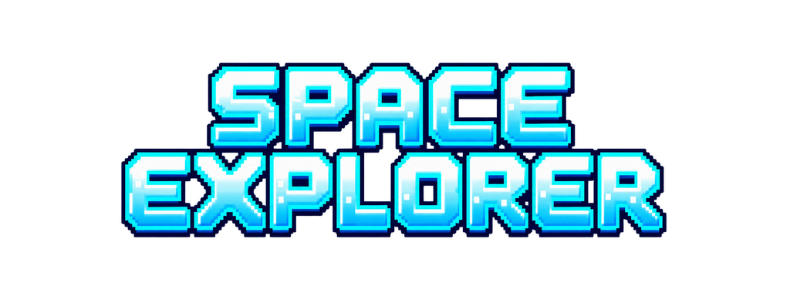
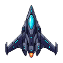
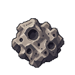
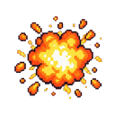
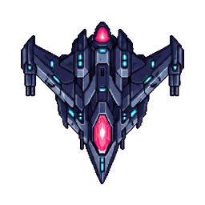

<p align="center"></p>

# Space Explorer — 2D Unity game (Lab 1, PRU213)

A 2D arcade shooter made in Unity 6 / URP 2D for **Lab 1 of PRU213**. You fly a
spaceship through a drifting asteroid field, shoot rocks apart, collect stars for
points, and face a boss warship once the score reaches 400.

The project covers the whole lab brief — the Unity interface and navigation, game
object manipulation, transforms, the component system, scene creation and
management, and an introduction to 2D physics and colliders — with a little extra
polish on top: a boss fight, medals with a persisted best score, runtime-synthesised
audio and fade transitions between scenes.

<p>





</p>

## Requirements

| | |
|---|---|
| Engine | Unity **6000.4.0f1** (Unity 6), pinned in `ProjectSettings/ProjectVersion.txt` |
| Render pipeline | Universal Render Pipeline 17.4.0 with the 2D Renderer |
| Input | Input System 1.19.0 |
| Third-party assets | none — every sprite and every sound ships with the project |

## Run it

1. Open the project folder with Unity Hub using Unity 6000.4.0f1.
2. Open `Assets/Scenes/MainMenu.unity`.
3. Press **Play**.

`File > Build And Run` also works: the three scenes are already enabled in Build
Settings, in the order Main Menu → Gameplay → End Game.

## Controls

| Action | Keyboard | Gamepad |
|---|---|---|
| Move the ship | Arrow keys, or WASD | Left stick |
| Fire lasers | Space (hold to keep firing) | South button (A / Cross) |
| Menus | Mouse, or arrows + Enter | D-pad / stick + South button |

## The game

- **Main Menu** — Play, Instructions (opens the how-to-play panel) and Quit.
- **Gameplay** — the ship starts with three lives and 1.5 s of blinking
  invulnerability after a hit. Asteroids fall with a random sprite, size, speed and
  spin; stars fall in a gentle wave. The HUD shows score, lives and the boss warning.
- **Boss** — at 400 points the asteroids pause and a 40 HP warship arrives. Beat it
  for 500 points; the next fight comes 1000 points later.
- **End Game** — final score, persisted best score, a "new record" badge, a bronze /
  silver / gold medal, and Replay, Main Menu and Quit buttons.

### Scoring

| Event | Points |
|---|---|
| Collect a star | **+50** |
| Destroy an asteroid (2 hit points) | **+10** |
| Ram an asteroid | **−50** and one life (no penalty while the shield is blinking) |
| Defeat the boss | **+500** |

The score is clamped at zero, and so is the best score stored in `PlayerPrefs`.

## Scenes

| Scene | Purpose |
|---|---|
| `Assets/Scenes/MainMenu.unity` | Title screen: Play, Instructions panel, Quit |
| `Assets/Scenes/Gameplay.unity` | The run: ship, asteroid and star spawners, HUD, boss |
| `Assets/Scenes/EndGame.unity` | Result screen: score, best score, medal, Replay / Home / Quit |

All three are connected by `SceneLoader`, which fades to black over 0.35 s, loads
the next scene asynchronously and fades back in.

## Project layout

```
Assets/
├── Art/          backgrounds, sprites and the UI kit (pixel art, 100 PPU)
├── Editor/       SpaceExplorerBuilder (regenerates prefabs + scenes), SpaceArtImporter
├── Prefabs/      Player, Laser, Asteroid, Star, Boss, BossBullet, Explosion
├── Scenes/       MainMenu, Gameplay, EndGame
├── Scripts/      Core, Gameplay, UI, Audio   (assembly "SpaceExplorer")
└── Settings/     URP 2D renderer and volume profile
```

## Lab 1 requirement check

| Requirement from the brief | Implementation |
|---|---|
| Main menu with Play and Instructions buttons | `MainMenuUI`, `MainMenu.unity` |
| Ship moved with the arrow keys, shooting lasers | `PlayerInputReader`, `PlayerMovement`, `PlayerWeapon` |
| Randomly moving asteroids, collectable stars | `Spawner` ×2, `Asteroid`, `Star` |
| Collision logic and scoring | `PlayerHealth`, `Asteroid`, `Star`, `ScoreKeeper`, `GameEvents` |
| Score display | `HudUI` |
| End game scene with the score and a way back | `EndGameUI`, `AppQuit` |
| Smooth scene transitions | `SceneLoader` (fade over `LoadSceneAsync`) |

Every type and every public member in the 33 C# files carries an XML documentation
block (34/34 types, 38/38 public members).

## Documentation

The full report — each game element and each scene, the requirement mapping,
verification performed and known limitations:

[`Space Explorer - Documentation.docx`](Space%20Explorer%20-%20Documentation.docx)

## Notes

- **Scenes and prefabs are generated.** `Space Explorer > Build Game`
  (`Assets/Editor/SpaceExplorerBuilder.cs`) rebuilds all seven prefabs and the
  three scenes from the art in `Assets/Art`. Hand edits inside `Assets/Scenes` or
  `Assets/Prefabs` are overwritten the next time the tool runs.
- **Three lives instead of instant death.** The brief ends the run on the first
  asteroid hit; that made the scoring and the boss unreachable, so the ship gets
  three lives. For the literal rule set `PlayerHealth.maxLives` to 1 and
  `invulnerableSeconds` to 0. The boss fight is likewise an addition and can be
  removed by disabling `BossDirector` on the Game Systems object.
- `Assets/Scenes/SampleScene.unity` and `Assets/InputSystem_Actions.inputactions`
  are leftovers from the Unity template and are not referenced by the game.
- There are no automated tests; the checks that were run are listed in section 8
  of the report.
